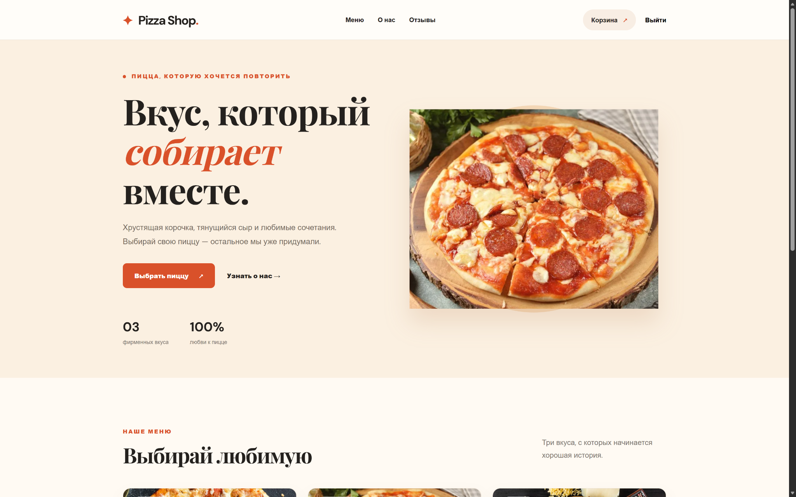
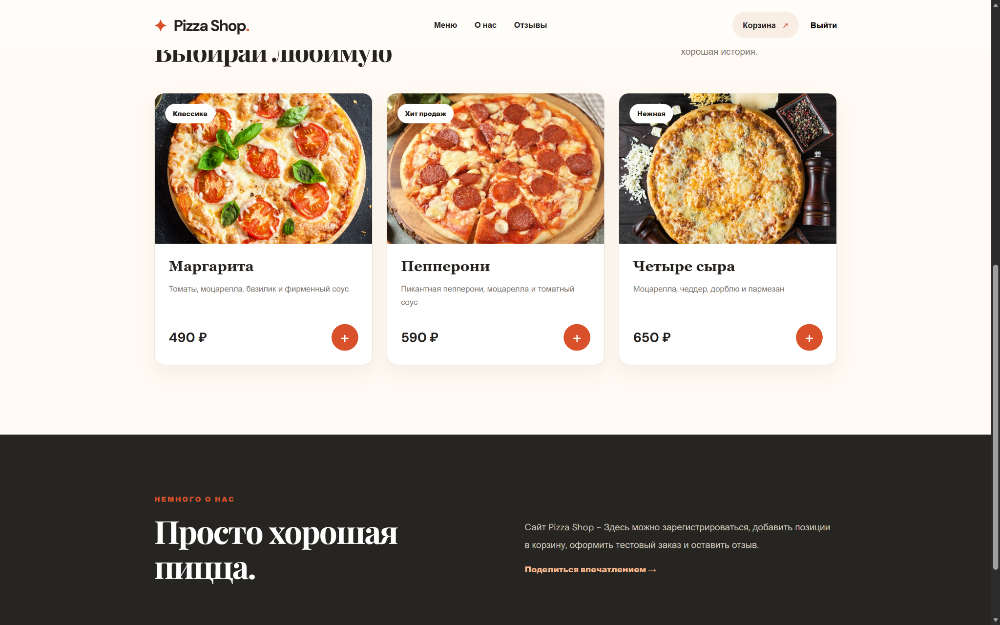
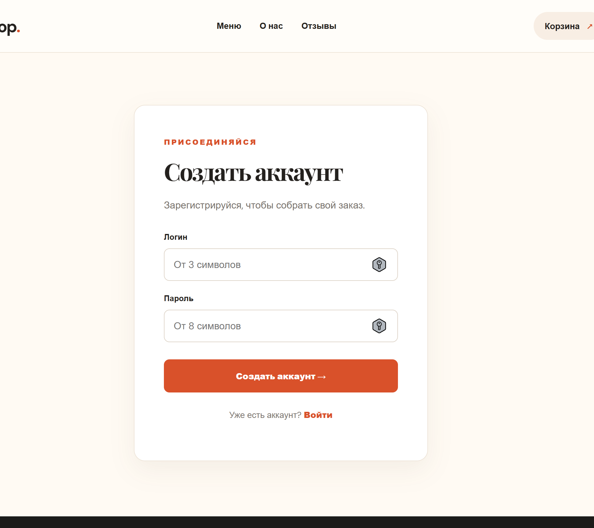
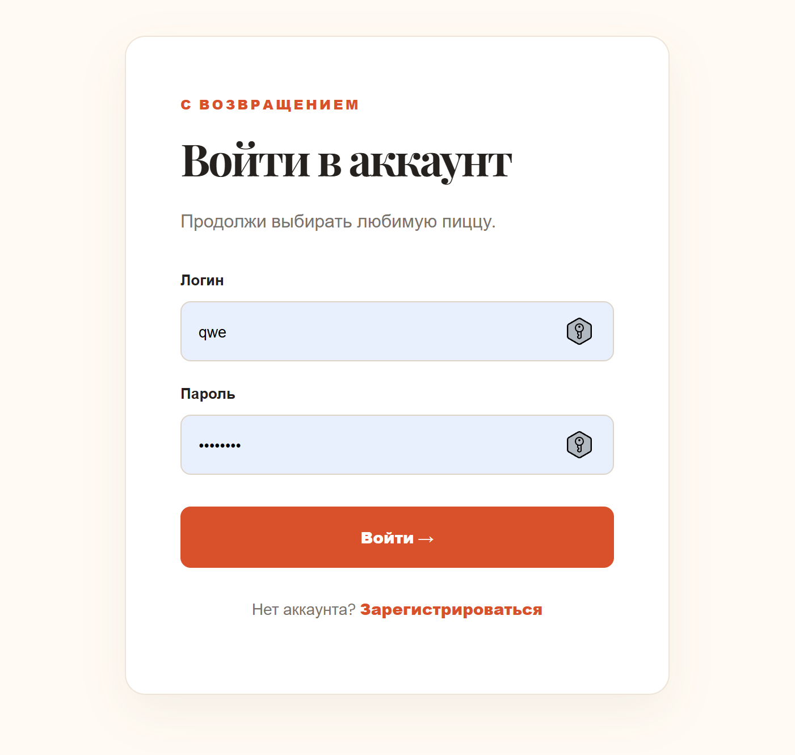
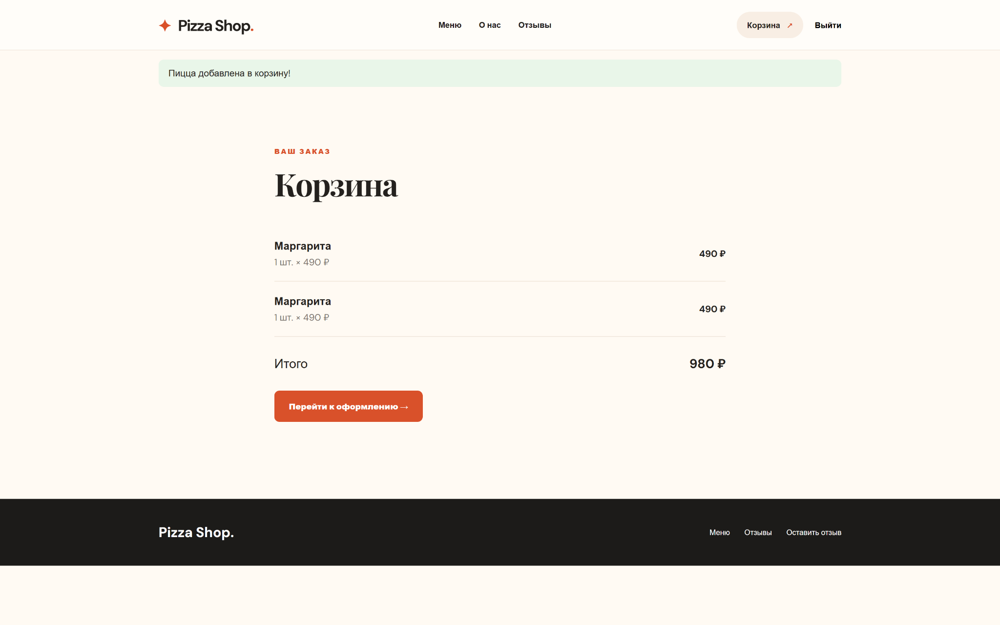
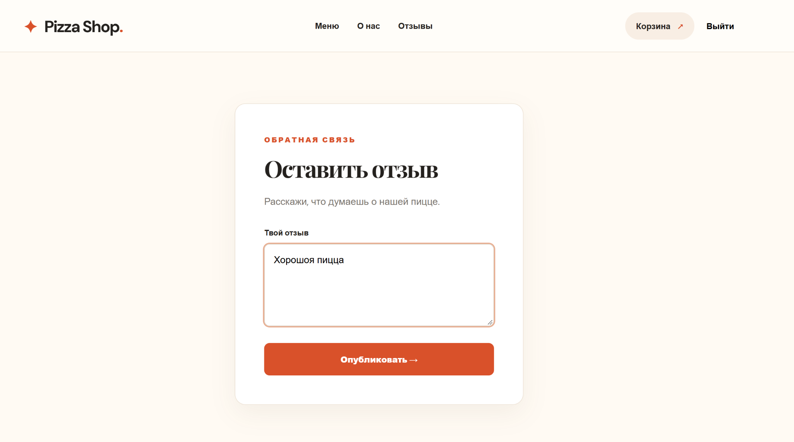
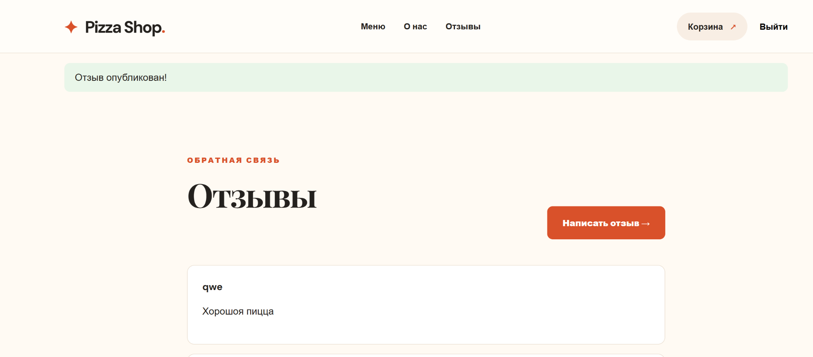

<div align="center">

# 🍕 Pizza Shop

**Веб-приложение интернет-пиццерии на Python и Flask**

Каталог пицц · Регистрация и вход · Корзина · Отзывы



</div>

## О проекте

**Pizza Shop** — учебный веб-проект, в котором реализован пользовательский интерфейс интернет-пиццерии и серверная логика на Flask. Проект демонстрирует работу с маршрутами, HTML-шаблонами, формами и пользовательскими сценариями.

## Возможности

- 🍕 Просмотр каталога пицц с описаниями и ценами.
- 👤 Регистрация пользователей и вход в аккаунт.
- 🛒 Добавление пицц в корзину и просмотр общей суммы.
- 🧾 Переход к оформлению тестового заказа.
- 💬 Создание и просмотр отзывов.
- 📱 Адаптивный интерфейс.

## Скриншоты

### Каталог пицц


### Регистрация и вход
| Регистрация | Вход |
|:---:|:---:|
|  |  |

### Корзина


### Отзывы
| Создание отзыва | Список отзывов |
|:---:|:---:|
|  |  |

## Технологии

- **Backend:** Python, Flask
- **Frontend:** HTML, CSS, JavaScript
- **Шаблоны:** Jinja2
- **Зависимости:** см. `requirements.txt`

## Запуск локально

Требуется установленный Python.

```bash
git clone https://github.com/rusakovm/pizza_shop.git
cd pizza_shop
python -m venv .venv
```

**Windows (CMD):**

```cmd
.venv\Scripts\activate.bat
pip install -r requirements.txt
python main_prog.py
```

Откройте в браузере: **http://127.0.0.1:5000/**

## Автор

**Konari** · [GitHub — rusakovm](https://github.com/rusakovm)
